# SpecLens

Local technical PDF extraction and comparison on Apple Silicon. Ask in English or Turkish, inspect the quoted source and open its original PDF page.


SpecLens combines BM25 and multilingual E5 retrieval with a 4-bit Qwen model running through MLX. The model selects source excerpt IDs; the application supplies the quotes, checks their provenance and retains rejected attempts for inspection. A deterministic tool compares explicit VIN ranges and units.

## Results

The frozen v3 candidate passed **40/48 complete-task reference checks**, compared with **25/48** for v2, on four product families excluded from development: Arduino Due, GIGA R1 WiFi, Nicla Sense ME and Edge Control. Median request time was **4.69 seconds**, p95 **9.37 seconds**, on an M4 Pro with 48 GiB unified memory.

These are automated field, value and source-reference checks, **not human-validated accuracy**. The 48 prompts are English/Turkish pairs of 24 base tasks. All sources come from the same publisher; document selection is supplied. Test inspection found both application failures and overly restrictive reference checks. The original scores remain unchanged; see the [failure analysis](docs/FAILURE_ANALYSIS.md) and [experiment comparison](docs/EXPERIMENTS.md).

| Dataset | Documents / families | Prompts / base tasks | v3 complete-task checks |
|---|---:|---:|---:|
| Development | 10 / 8 | 30 / 15 | 28/30 |
| Held-out test | 4 / 4 | 48 / 24 | 40/48 |

The demo indexes the 10 development PDFs: 195 pages and 257 chunks. The separate test corpus adds 101 pages and 132 chunks. Test labels, source hashes, the implementation freeze and full model responses are included in the repository. Labels were authored and checked by the coding agent; human review is pending.

## Run locally

Requirements: Apple Silicon, native macOS, Python 3.12 and `uv`. The measured host is an M4 Pro / 48 GiB; smaller Macs have not been benchmarked. No paid API, hosted vector database or cloud GPU is required. Initial setup downloads packages, models and documents; inference then uses cached files.

```bash
make bootstrap
make check
make run
```

Open [localhost:8010](http://127.0.0.1:8010). On an already prepared checkout, only `make run` is needed. Ctrl-C stops both the API and MLX worker. Logs are in `logs/`; the launcher refuses occupied ports.

The main environment contains PDF processing, retrieval and PyTorch. `environments/llm` isolates MLX and its dependencies. Both are locked. Run inference, bulk embedding and training sequentially; Linux containers are not the Metal execution path.

Producer URLs can change. Acquisition checks pinned PDF and Markdown hashes and stops on a mismatch. To reproduce the exact source snapshots, restore the prepared corpus archive before `make data`; instructions and the archive checksum are in [REPRODUCING.md](docs/REPRODUCING.md).

## Use the CLI

With `make run` active in another terminal:

```bash
export PYTHONPATH="$PWD/src"
uv run --locked speclens answer \
  'UNO R4 Minima ve Nano ESP32 için önerilen VIN aralıklarını ver.' \
  --document uno-r4-minima --document nano-esp32

uv run --locked speclens compare-vin \
  --document uno-r4-minima --document nano-esp32 --target 24 --unit V
```

Retrieval also works without the LLM worker:

```bash
uv run --locked speclens search 'Önerilen VIN giriş gerilimi nedir?' \
  --document nano-esp32 --method hybrid_expanded
```

## How it works

```mermaid
flowchart LR
    PDF[Hashed PDF snapshot] --> Pages[Page text chunks]
    Pages --> Search[BM25 + multilingual E5]
    Search --> Budget[Balanced context / token budget]
    Budget --> LLM[Qwen 4B / MLX]
    LLM --> IDs[Structured fields / excerpt IDs]
    IDs --> Checks[Schema / source / numeric-token checks]
    Checks --> Repair[One bounded repair if needed]
    Repair --> UI[Findings / PDF pages / audit JSON]
    UI --> Compare[Explicit VIN range comparison]
```



The v3 pipeline restricts requested fields, rejects duplicates and unknown evidence IDs, stops generation at a complete JSON object, and permits one repair attempt. A narrow, separately recorded rule recovers literal memory capacities when the model abstains. It does not convert bits to bytes or infer missing specifications. Every response records the prompt hash, source hash, attempts, timings and any rule recovery.

A valid source quotation establishes where text came from; it does not prove the model interpreted it correctly. `not_stated` means unavailable in the supplied evidence, not that the product lacks a capability. Numeric-token checks likewise do not establish unit or scope correctness.

## Verify and reproduce

```bash
make check          # 61 CPU tests, lint, development labels and local snapshots
make test-data      # prepare the separate held-out corpus and CPU embeddings
make check-release  # verify the frozen implementation, labels and source excerpts
make benchmark      # worker must be running; saves a new report, never overwrites
```

The test was sealed before either held-out model run. Using its failures to tune a future version requires a new holdout. See [dataset details](data/evaluation/README.md), [human review worksheet](docs/ANNOTATION_REVIEW.md), and [contribution rules](CONTRIBUTING.md).

The 61-test suite also passed in a clean CPU environment without PyTorch. GitHub Actions is configured for CPU checks; remote CI has not run. Local Metal inference was exercised with the real model. The synthetic LoRA experiment is a runtime check only; its adapter is **not served** and no fine-tuning quality gain is claimed.

## Scope and project materials

Supported: curated text-layer English PDFs, English/Turkish questions, source-page previews, structured export and explicit VIN comparisons. OCR, diagrams, arbitrary uploads, automatic semantic verification, a production adapter and multi-user hosting are outside this release.

- [Experiment results and measurement limits](docs/EXPERIMENTS.md)
- [Failure analysis and next work](docs/FAILURE_ANALYSIS.md)
- [Reproduction and release files](docs/REPRODUCING.md)
- [Portfolio case study and CV wording](docs/PORTFOLIO.md)
- [Original development plan, in Turkish](docs/SPECLENS_PLAN.md)

Original code is MIT licensed. Arduino source material and derived excerpts retain their attribution and CC BY-SA 4.0 terms; see [THIRD_PARTY.md](THIRD_PARTY.md). Model revisions and licenses are pinned in `configs/models.json`. Weights, adapters, raw PDFs and environments are excluded from Git.
