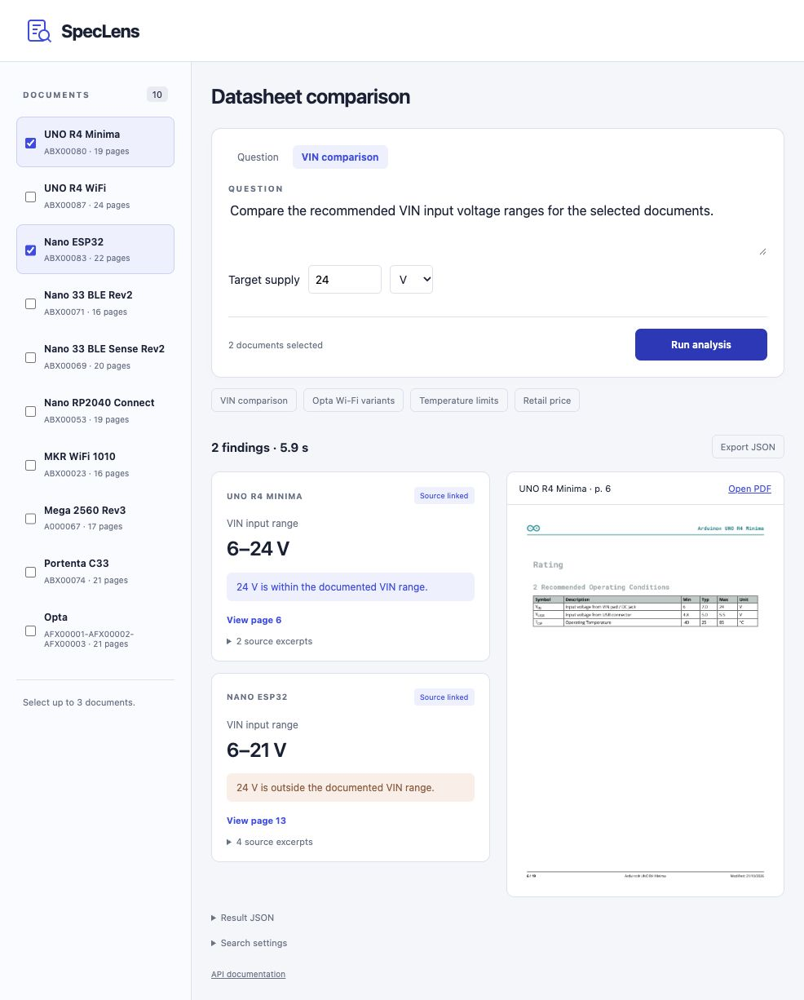

# SpecLens

[](https://github.com/onurozansunger/SpecLens/actions/workflows/tests.yml)

Extract and compare technical specifications from PDFs using English or Turkish questions. Runs locally on Apple Silicon.



BM25 and multilingual E5 retrieve source passages. Qwen3-4B runs through MLX and returns structured fields with excerpt IDs. The application reconstructs citations from the source, validates fields and numeric tokens, and allows one repair attempt. VIN comparisons use deterministic unit and range checks.

## Installation

Requires Apple Silicon, native macOS, Python 3.12 and `uv`. Tested on an M4 Pro with 48 GiB unified memory. Setup downloads packages, models and documents; inference uses local cached files without paid APIs.

```bash
git clone https://github.com/onurozansunger/SpecLens.git
cd SpecLens
make bootstrap
make check
make run
```

Open [localhost:8010](http://127.0.0.1:8010). For subsequent runs, use `make run`. Ctrl-C stops the API and MLX worker. Logs are written to `logs/`.

The application and MLX worker use separate locked environments. Run bulk embedding, inference and training sequentially. Source downloads are checked against pinned hashes; see [reproduction instructions](docs/REPRODUCING.md) if an upstream file has changed.

## CLI

With `make run` active in another terminal:

```bash
export PYTHONPATH="$PWD/src"
uv run --locked speclens answer \
  'What are the recommended VIN ranges for UNO R4 Minima and Nano ESP32?' \
  --document uno-r4-minima --document nano-esp32

uv run --locked speclens compare-vin \
  --document uno-r4-minima --document nano-esp32 --target 24 --unit V
```

Retrieval also works without the LLM worker:

```bash
uv run --locked speclens search 'What is the recommended VIN input voltage range?' \
  --document nano-esp32 --method hybrid_expanded
```

## Evaluation

| Dataset | Documents / families | Prompts / base tasks | v3 complete-task checks |
|---|---:|---:|---:|
| Development | 10 / 8 | 30 / 15 | 28/30 |
| Held-out test | 4 / 4 | 48 / 24 | 40/48 |

On the held-out test, v2 passed 25/48 complete-task checks and v3 passed 40/48. Median v3 request time was 4.69 seconds; p95 was 9.37 seconds on the M4 Pro. The demo indexes 195 pages and 257 chunks; the separate test corpus contains 101 pages and 132 chunks.

These are automated field, value and source-reference checks. Labels are agent-authored and await human review. The 48 test prompts are 24 English/Turkish pairs across four Arduino product families excluded from development. Document filters are supplied, and all sources share a publisher. [Experiment details](docs/EXPERIMENTS.md) and [failure analysis](docs/FAILURE_ANALYSIS.md) describe the measurement limits and known errors.

```bash
make check          # 61 CPU tests, lint, development labels and local snapshots
make test-data      # prepare the separate held-out corpus and CPU embeddings
make check-release  # verify the frozen implementation, labels and source excerpts
make benchmark      # worker must be running; saves a new report, never overwrites
```

The 61-test suite passed in a clean CPU environment without PyTorch. GitHub Actions runs the CPU checks; Metal inference is tested locally. The test was sealed before evaluation. Tuning on its failures requires a new holdout for the next version.

## Limitations

Supports curated English PDFs with a text layer. OCR, diagrams, arbitrary uploads and multi-user hosting are not implemented. The application uses the base model; the experimental LoRA adapter is not served.

Citation validation confirms that the quoted text exists, not that the model interpreted it correctly. `not_stated` means the answer was unavailable in the supplied evidence. Numeric-token checks do not establish unit or scope correctness.

## Documentation

- [Experiment results](docs/EXPERIMENTS.md)
- [Failure analysis](docs/FAILURE_ANALYSIS.md)
- [Reproduction instructions](docs/REPRODUCING.md)
- [Dataset and split protocol](data/evaluation/README.md)

## License

Original code is MIT licensed. Arduino source material and derived excerpts retain their attribution and CC BY-SA 4.0 terms; see [THIRD_PARTY.md](THIRD_PARTY.md). Model revisions and licenses are pinned in `configs/models.json`. Weights, adapters, raw PDFs and environments are excluded from Git.
